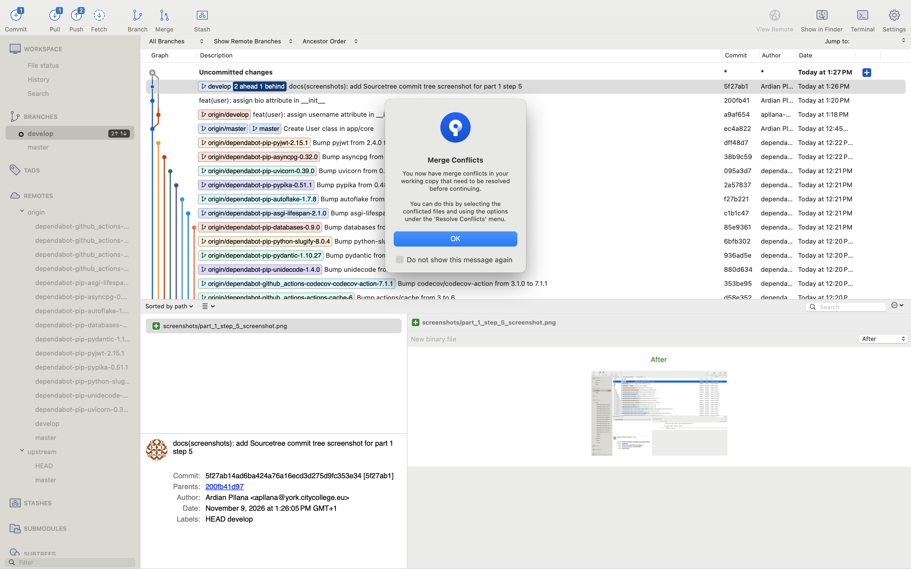
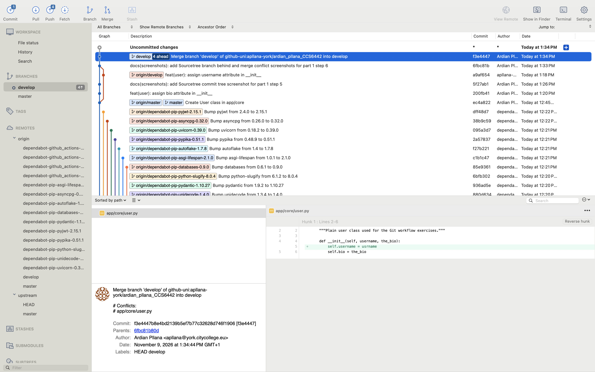

# Data Science Toolbox - Solution Workflow
## Part 1

---
### Step 6 - Resolving conflict
**Cause:** The `develop` branch had changes on remote that the local branch did not have yet. Meaning that the local branch was created before the change (step 3) was done on the remote branch. Therefore, it didn't allow to push the local changes because it was behind with changes.

**Solution:** To fix this issue, I first fetched the `develop` branch and pulled upcoming changes. This showed me that there were conflicts.

 On my IDE (PyCharm), I went to the file and resolved the conflict which in this case meant keeping both changes of remote and local. After that I created a new commit with the merge conflict resolved and finally pushed the changes to remote. 

>**Prevention:** 
>* Always fetch and pull before pushing to make sure the branch is up to date with remote.
>* Have no more than one developer working on a branch at a time.
---
### Step 19 - Addressing the Pull Request
**Cause:** The pull request was created with a commit `"Some changes""` and variable naming `p2`. This commit message is unclear and does not tell the reader what the PR is actually about. The variable naming `p2` doesn't follow the naming consistency from existing code, i.e. `user1`. Both of these practices result in bad coding habits which then leads to other issues like bad readability, documentation etc.

**Solution:** As a PR reviewer, I left a [comment](https://github.com/apllana-york/ardian_pllana_CCS6442/pull/16#issuecomment-6769222387) explaining why the PR can't be merged and what steps need to be followed to resolve it:

    - This PR can't be merged, mainly because of the commit message.
        - "Some changes" doesn't describe what the commit or the PR does. Commit messages should be short and clear, explaining what the change is or does. Example: feat(step-4): create and print a second user in main_runner
        - The variable p2 doesn't explain what it holds. Please use a descriptive name, e.g. user2.
    Fix:
        - Create a new branch from develop with the corrected changes.
        - Commit them with a descriptive commit message.
        - Open a new PR targeting develop and close this one.
Since the changes were already pushed and PR was created, I thought it would be best to create a new branch and move the corrected changes there. This would ensure that when the new PR is created with the right commit message, it can merged without containing the previous commit and it looks cleaner when looking at the code history. I also put a versioning to the new branch in case other issues come up and a new branch needs to be created again. Of course, it's best practice to delete old branches or unneeded ones, but in case it is required to keep them, then with versioning we can prevent branches like `step-4-fix`, `step-4-final-fix`, `step-4-final-fantasy-vii-fix` etc.

>**Prevention:** 
>* Always make sure that the commit message is short and clear explaining what the change does or includes.
>* Have the team define what patterns need the commit messages to follow.
>* For young or new developer reviewing other developers PRs, especially if they are lead or seniors, is a good practice since you can learn from what and how they do their work.
---
### Step 21:
**Cause:** The Project Manager is requesting to deploy and completed developed features to production, in our case `master` branch.

**Solution:** 
1. Make sure that appropriate PRs have been closed and merged to develop. 
This meant for me to complete `feature/step-1` by: 
   * Pulling new changes from `develop` and resolving conflicts.
   * Commiting and pushing last changes.
   * Creating PR and merging it after approval. 
   
 However, `feature/step-3` was not included since it was at that time still an open PR.
2. Create a `release/1.0.0` branch from develop.
3. Create the [pull request](https://github.com/apllana-york/ardian_pllana_CCS6442/pull/19) to merge `release/1.0.0` to `master`, making sure the description tells what this release includes.
4. Assign PR reviewers, and await approval from the appropriate persons.
5. Merge `release/1.0.0` to `master` and tag `master` with `v1.0.0`. This makes it easier to keep track what version is on prod.
6. Merge `release/1.0.0` back to `develop`

>**Prevention:** 
> * Can't be prevented since this is part of Software Development Life Cycle (SDLC).
> * Make sure the correct steps are followed.
> * Monitor system minimum 24h after release to make sure everything is running smoothly.

---
### Step 22:
**Cause:** Requesting to continue working on new features after the release.

**Solution:** Merging `release/1.0.0` back to `develop` from previous step (21), ensures that `develop` is up to date with production and implementation of new features can continue. I created new `feature/step-5` branch from `develop` and made the changes there.

>**Prevention:** 
> None.

---
### Step 23:
**Cause:** There was a uncaught bug in code that was deployed to production and now it needs to be fixed as soon as possible.

**Solution:** Since this is a fix that is needed to be implemented on prod as soon as possible, the correct branch to reflect this change is a `hotfix/` branch. Hotfix indicates that the branch includes a production fix, and the versioning after tells us for which version. 
1. Create `hotfix/1.0.1` directly from `master`.
2. Make the fix, commit and push the changes.
3. Create pull request to merge `hotfix/1.0.1` to `master`, assign reviewers and merge after approval.
4. Tag `master` to `v1.0.1`.
5. Create pull request to merge `hotfix/1.0.1` to `develop`. (Best practice to create PR, but I forgot to do it and merged it straight to develop!)
6. On `feature/step-5` fetch and pull changes from `develop` so it includes the bug fix as well.

>**Prevention:** 
> * Always test code before creating PRs or merging, especially to production.
> * Make sure that others have reviewed and approved your PR.
> * Again, monitor system minimum 24h after release to make sure to catch bugs or errors as soon as possible.

## Part 2 - Upcoming