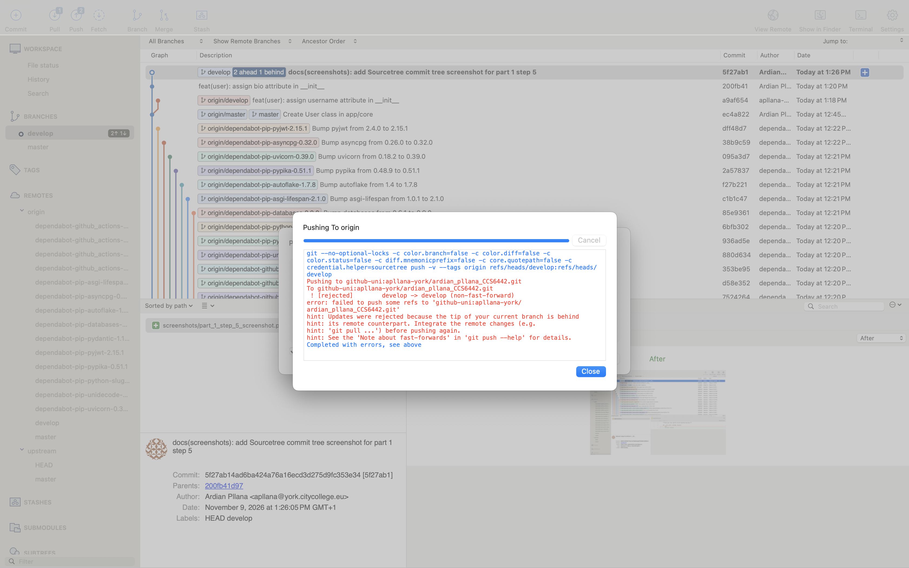

# Data Science Toolbox - Solution Workflow

---
## Part 1

### Step 6 - Resolving conflict
**Cause:** The `develop` branch had changes on remote that the local branch did not have yet. Meaning that the local branch was created before the change (step 3) was done on the remote branch. Therefore, it didn't allow to push the local changes because it was behind with changes.


**Solution:** To fix this issue, I first fetched the `develop` branch and pulled upcoming changes. This showed me that there were conflicts.<p>

 On my IDE (PyCharm), I went to the file and resolved the conflict which in this case meant keeping both changes of remote and local. After that I created a new commit with the merge conflict resolved and finally pushed the changes to remote. <p>


>**Prevention:** 
>* Always fetch and pull before pushing to make sure the branch is up to date with remote.
>* Have no more than one developer working on a branch at a time.
---
### Step 19 - Addressing the Pull Request
**Cause:** The pull request was created with a commit `"Some changes""` and variable naming `p2`. This commit message is unclear and does not tell the reader what the PR is actually about. The variable naming `p2` doesn't follow the naming consistency from existing code, i.e. `user1`. Both of these practices result in bad coding habits which then leads to other issues like bad readability, documentation etc.

**Solution:** As a PR reviewer, I left a [comment](https://github.com/apllana-york/ardian_pllana_CCS6442/pull/16#issuecomment-6769222387) explaining why the PR can't be merged and what steps need to be followed to resolve it:

    - This PR can't be merged, mainly because of the commit message.
        - "Some changes" doesn't describe what the commit or the PR does. Commit messages should be short and clear, explaining what the change is or does. Example: feat(step-4): create and print a second user in main_runner
        - The variable p2 doesn't explain what it holds. Please use a descriptive name, e.g. user2.
    Fix:
        - Create a new branch from develop with the corrected changes.
        - Commit them with a descriptive commit message.
        - Open a new PR targeting develop and close this one.
Since the changes were already pushed and PR was created, I thought it would be best to create a new branch and move the corrected changes there. This would ensure that when the new PR is created with the right commit message, it can merged without containing the previous commit and it looks cleaner when looking at the code history. I also put a versioning to the new branch in case other issues come up and a new branch needs to be created again. Of course, it's best practice to delete old branches or unneeded ones, but in case it is required to keep them, then with versioning we can prevent branches like `step-4-fix`, `step-4-final-fix`, `step-4-final-fantasy-vii-fix` etc.

>**Prevention:** 
>* Always make sure that the commit message is short and clear explaining what the change does or includes.
>* Have the team define what patterns need the commit messages to follow.
>* For young or new developer reviewing other developers PRs, especially if they are lead or seniors, is a good practice since you can learn from what and how they do their work.
---
### Step 21:
**Cause:** The Project Manager is requesting to deploy and completed developed features to production, in our case `master` branch.

**Solution:** 
1. Make sure that appropriate PRs have been closed and merged to develop. <p>This meant for me to complete `feature/step-1` by: 
   * Pulling new changes from `develop` and resolving conflicts.
   * Commiting and pushing last changes.
   * Creating PR and merging it after approval. 
   <p> However, `feature/step-3` was not included since it was at that time still an open PR.
2. Create a `release/1.0.0` branch from develop.
3. Create the [pull request](https://github.com/apllana-york/ardian_pllana_CCS6442/pull/19) to merge `release/1.0.0` to `master`, making sure the description tells what this release includes.
4. Assign PR reviewers, and await approval from the appropriate persons.
5. Merge `release/1.0.0` to `master` and tag `master` with `v1.0.0`. This makes it easier to keep track what version is on prod.
6. Merge `release/1.0.0` back to `develop`

>**Prevention:** 
> * Can't be prevented since this is part of Software Development Life Cycle (SDLC).
> * Make sure the correct steps are followed.
> * Monitor system minimum 24h after release to make sure everything is running smoothly.

---
### Step 22:
**Cause:** Requesting to continue working on new features after the release.

**Solution:** Merging `release/1.0.0` back to `develop` from previous step (21), ensures that `develop` is up to date with production and implementation of new features can continue. I created new `feature/step-5` branch from `develop` and made the changes there.

>**Prevention:** 
> None.

---
### Step 23:
**Cause:** There was a uncaught bug in code that was deployed to production and now it needs to be fixed as soon as possible.

**Solution:** Since this is a fix that is needed to be implemented on prod as soon as possible, the correct branch to reflect this change is a `hotfix/` branch. Hotfix indicates that the branch includes a production fix, and the versioning after tells us for which version. 
1. Create `hotfix/1.0.1` directly from `master`.
2. Make the fix, commit and push the changes.
3. Create pull request to merge `hotfix/1.0.1` to `master`, assign reviewers and merge after approval.
4. Tag `master` to `v1.0.1`.
5. Create pull request to merge `hotfix/1.0.1` to `develop`. (Best practice to create PR, but I forgot to do it and merged it straight to develop!)
6. On `feature/step-5` fetch and pull changes from `develop` so it includes the bug fix as well.

>**Prevention:** 
> * Always test code before creating PRs or merging, especially to production.
> * Make sure that others have reviewed and approved your PR.
> * Again, monitor system minimum 24h after release to make sure to catch bugs or errors as soon as possible.

---
## Part 2

### Creating postgres image
1. Created `.env` file containing `POSTGRES_USER`, `POSTGRES_PASSWORD`, `POSTGRES_DB` and `POSTGRES_PORT`.
2. Edited `docker-compose.yml` to pull values from the `.env` file.
3. `.env` is listed in `.gitignore` so credentials are never committed.
4. First decided to create with version 18 postgres but faced some issues since they changed the volume paths. Decided to continue with 17 since this was before that change.
5. Tested the service by running `docker compose up -d postgres` command.
```
linkplus@Dobby-Macbook fastapi-realworld-example-app % docker compose up -d postgres
[+] Running 1/1
 ⠿ Container postgres  Started     
```

### Creating a custom Dockerfile
#### checkstatus.sh
1. Created checkstatus.sh file
2. Checked the documentation to see what `pg_isready` does. `pg_isready` returns:
   - `0` if the server is accepting connections normally.
   - `1` if the server is rejecting connections.
   - `2` if there was no response to the connection attempt.
   - `3` if no attempt was made.
3. Used an `until` loop to retry every 2 seconds until `pg_isready` returns `0`.
4. While testing, I noticed that `username`, `password` and `db` are redundant, only `host` and `port` are required for `pg_isready`.
```
linkplus@Dobby-Macbook fastapi-realworld-example-app % POSTGRES_HOST=postgres POSTGRES_PORT=5432 sh src/checkstatus.sh
Waiting for database at postgres:5432...
Database is ready!
```

#### Production-Dockerfile
1. I decided to go with [Alpine 3.24](https://hub.docker.com/_/alpine).
2. Used https://pkgs.alpinelinux.org/contents to find which apk to run for Alpine v3.24 and Postgres 17.
3. The Dockerfile copies `checkstatus.sh` into the image at `/usr/local/bin/checkstatus.sh`, following Linux convention for [custom executables](https://stackoverflow.com/questions/9168432/unix-standard-directory-to-put-custom-executables-or-scripts).
4. CMD tells what script to run when container starts.

### Combining them together
1. Added `checkstatus` service to `docker-compose.yml`.
2. Tested running `docker compose up --build postgres checkstatus`.
``` 
linkplus@Dobby-Macbook fastapi-realworld-example-app % docker compose up --build postgres checkstatus
[+] Building 1.3s (9/9) FINISHED                                                                                                                                                                        
 => [internal] load build definition from Production-Dockerfile                                                                                                                                    0.0s
 => => transferring dockerfile: 279B                                                                                                                                                               0.0s
 => [internal] load .dockerignore                                                                                                                                                                  0.0s
 => => transferring context: 2B                                                                                                                                                                    0.0s
 => [internal] load metadata for docker.io/library/alpine:3.24                                                                                                                                     0.9s
 => [internal] load build context                                                                                                                                                                  0.0s
 => => transferring context: 36B                                                                                                                                                                   0.0s
 => [1/4] FROM docker.io/library/alpine:3.24@sha256:f59abe656b692d901e184be3445e084786602108599d2a51d229c0f5a48c71bf                                                                               0.0s
 => CACHED [2/4] RUN apk add --no-cache postgresql17-client                                                                                                                                        0.0s
 => [3/4] COPY  checkstatus.sh  /usr/local/bin/checkstatus.sh                                                                                                                                      0.0s
 => [4/4] RUN chmod +x /usr/local/bin/checkstatus.sh                                                                                                                                               0.2s
 => exporting to image                                                                                                                                                                             0.0s
 => => exporting layers                                                                                                                                                                            0.0s
 => => writing image sha256:597d7223385754afb54022e5cbee285e29769d760f09e092ad2ad2b52e9da66e                                                                                                       0.0s
 => => naming to docker.io/library/fastapi-realworld-example-app-checkstatus                                                                                                                       0.0s

Use 'docker scan' to run Snyk tests against images to find vulnerabilities and learn how to fix them
[+] Running 2/2
 ⠿ Container postgres                                     Running                                                                                                                                  0.0s
 ⠿ Container fastapi-realworld-example-app-checkstatus-1  Recreated                                                                                                                                0.1s
Attaching to fastapi-realworld-example-app-checkstatus-1, postgres
fastapi-realworld-example-app-checkstatus-1  | Waiting for database at postgres:5432...
fastapi-realworld-example-app-checkstatus-1  | Database is ready!
fastapi-realworld-example-app-checkstatus-1 exited with code 0
```

### Getting ready for production
1. Merged all features and PRs including `step-5` that never got merged from Part 1.
2. Created `release/2.0.0` branch.
3. Created release PR, approved it and left the screenshot as a comment, then merged it.
4. Tagged release, merged release back to develop

### A grave mistake
1. Created `hotfix/2.0.1` from `master`, a patch bump because it is an urgent production fix with no new features.
2. Found the correct `citycase/assessment2` image version from https://hub.docker.com/r/citycase/assessment2?tag=2.0.
3. Tested it but the build failed on `apk add --no-cache postgresql17-client`. The build log shows that `citycase/assessment2:2.0` is based on **Alpine 3.16** (it fetches packages from `alpine/v3.16`), and Alpine 3.16's repositories don't include a `postgresql17-client` package, since PostgreSQL 17 was released after Alpine 3.16.

```
linkplus@Dobby-Macbook fastapi-realworld-example-app % docker compose up --build postgres checkstatus
[+] Building 1.4s (6/8)                                                                                                                                                                                 
 => [internal] load build definition from Production-Dockerfile                                                                                                                                    0.0s
 => => transferring dockerfile: 292B                                                                                                                                                               0.0s
 => [internal] load .dockerignore                                                                                                                                                                  0.0s
 => => transferring context: 2B                                                                                                                                                                    0.0s
 => [internal] load metadata for docker.io/citycase/assessment2:2.0                                                                                                                                0.0s
 => [1/4] FROM docker.io/citycase/assessment2:2.0                                                                                                                                                  0.0s
 => [internal] load build context                                                                                                                                                                  0.0s
 => => transferring context: 245B                                                                                                                                                                  0.0s
 => ERROR [2/4] RUN apk add --no-cache postgresql17-client                                                                                                                                         1.2s 
------                                                                                                                                                                                                  
 > [2/4] RUN apk add --no-cache postgresql17-client:                                                                                                                                                    
#0 0.278 fetch https://dl-cdn.alpinelinux.org/alpine/v3.16/main/x86_64/APKINDEX.tar.gz                                                                                                                  
#0 0.628 fetch https://dl-cdn.alpinelinux.org/alpine/v3.16/community/x86_64/APKINDEX.tar.gz
#0 1.133 ERROR: unable to select packages:
#0 1.193   postgresql17-client (no such package):
#0 1.193     required by: world[postgresql17-client]
------
failed to solve: executor failed running [/bin/sh -c apk add --no-cache postgresql17-client]: exit code: 1
```
4. Solved it by changing `postgresql17-client` to `postgresql-client`, which installs the default PostgreSQL client for that Alpine release.

```
linkplus@Dobby-Macbook fastapi-realworld-example-app % docker compose up --build postgres checkstatus
[+] Building 2.0s (9/9) FINISHED                                                                                                                                                                        
 => [internal] load build definition from Production-Dockerfile                                                                                                                                    0.0s
 => => transferring dockerfile: 290B                                                                                                                                                               0.0s 
 => [internal] load .dockerignore                                                                                                                                                                  0.0s 
 => => transferring context: 2B                                                                                                                                                                    0.0s 
 => [internal] load metadata for docker.io/citycase/assessment2:2.0                                                                                                                                0.0s 
 => CACHED [1/4] FROM docker.io/citycase/assessment2:2.0                                                                                                                                           0.0s
 => [internal] load build context                                                                                                                                                                  0.0s 
 => => transferring context: 36B                                                                                                                                                                   0.0s 
 => [2/4] RUN apk add --no-cache postgresql-client                                                                                                                                                 1.4s 
 => [3/4] COPY  checkstatus.sh  /usr/local/bin/checkstatus.sh                                                                                                                                      0.0s
 => [4/4] RUN chmod +x /usr/local/bin/checkstatus.sh                                                                                                                                               0.3s 
 => exporting to image                                                                                                                                                                             0.1s
 => => exporting layers                                                                                                                                                                            0.1s 
 => => writing image sha256:4a7062184b7c1449550b162145ecee2f402781d054568a5e07dceed7da43b9b9                                                                                                       0.0s 
 => => naming to docker.io/library/fastapi-realworld-example-app-checkstatus                                                                                                                       0.0s 
                                                                                                                                                                                                        
Use 'docker scan' to run Snyk tests against images to find vulnerabilities and learn how to fix them
[+] Running 2/2
 ⠿ Container postgres                                     Running                                                                                                                                  0.0s
 ⠿ Container fastapi-realworld-example-app-checkstatus-1  Created                                                                                                                                  0.1s 
Attaching to fastapi-realworld-example-app-checkstatus-1, postgres                                                                                                                                      
fastapi-realworld-example-app-checkstatus-1  | Waiting for database at postgres:5432...
fastapi-realworld-example-app-checkstatus-1  | Database is ready!
fastapi-realworld-example-app-checkstatus-1 exited with code 0
```
5. Create hotfix PR, approve it, merge it.
6. Tag `master` with `Release-v.2.0.1`.
6. Merge hotfix to `develop`.